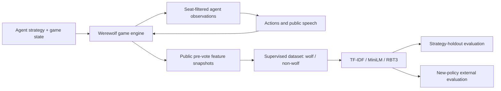
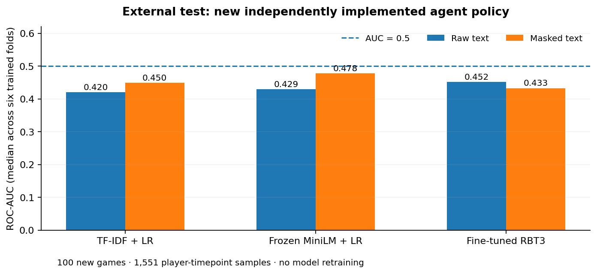
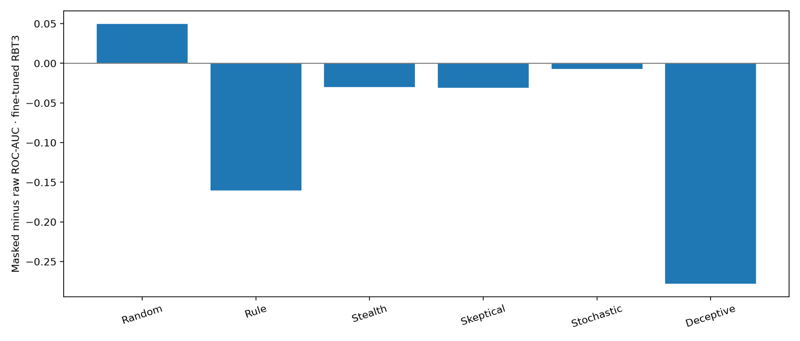

# Werewolf Lab

### How well do machine-learning models identify hidden roles when agents change their strategies?

**Independent research project · Keyi Wang · 2026**  
`Python` · `PyTorch` · `Transformers` · `scikit-learn` · `Multi-Agent Systems`

> **In brief:** I extended an existing AI Werewolf engine into a controlled research environment, constructed **19,728 public pre-vote observations** from **1,200 simulated games**, and compared classical NLP baselines, frozen sentence embeddings, and a **fully fine-tuned 38.5M-parameter RBT3 Transformer**. I then tested **36 previously trained model configurations** on **100 games generated by a separately implemented agent policy**. **34/36 ROC-AUC scores were below 0.5** on that external synthetic-policy test—evidence of limited transfer in this specific setup, not a general claim about AI reasoning.

**Quick navigation:** [My contribution](#what-i-contributed) · [Model comparison](#modeling-and-experimental-design) · [Key result](#key-result-limited-transfer-to-a-new-agent-policy) · [Selected code](#selected-code-and-evidence) · [Limits](#scope-and-limitations)

## The problem

Werewolf is a social-deduction game with **asymmetric information**: players speak and vote in public, but some have private information or incentives to deceive. I use it as a testbed for a supervised-learning question:

- **Input:** public speech, player mentions, and voting behavior available **before** a daytime vote.
- **Prediction target:** whether a living player is a **werewolf** (`1`) or a non-werewolf (`0`).
- **Research question:** does the learned ranking transfer when the agents' decision and speech policies change?

**The agents that play the game and the classifier that predicts roles are separate components.** The classifier does not make the agents' game decisions.

## What I contributed

| Area | My work |
|---|---|
| **Simulation & data** | Eight-agent offline experiments; role-filtered observations and replay/audit checks; supervised pre-vote data extraction with restricted public features |
| **Evaluation design** | Six synthetic strategy families, game-/seed-grouped splits, leave-one-strategy-family-out tests, masking ablations and game-cluster bootstrap confidence intervals |
| **Deep learning** | Full-parameter fine-tuning of RBT3 (~38.5M trainable parameters) with validation-based checkpoint selection; comparison with TF-IDF and frozen multilingual MiniLM |
| **External validity** | A separately implemented agent policy, 100 new simulated games, and no-retraining evaluation of all 36 previously trained configurations |
| **Research judgment** | Investigated apparent role-language shortcuts, calibration and selective prediction, and reported unfavorable results instead of selecting only high-scoring models |

AI-assisted coding tools supported implementation; the experiments, validation and interpretation remain documented as part of my project work. For attribution, see [NOTICE.md](NOTICE.md) and [UPSTREAM_LICENSE.txt](UPSTREAM_LICENSE.txt).

## Modeling and experimental design



The **1,200-game benchmark** consists of six *related* synthetic agent families—random, rule, stealth, skeptical, stochastic and deceptive—with **19,728** player-timepoint observations. A held-out family supplies test games, while models train and validate on other families. Data processing is fitted to the training partition, and examples from a game are grouped together. The six families share simulation infrastructure and speech templates; they are **not six independent real-world strategy sources**.

The text-model comparison uses **six trained folds × three NLP methods × two text conditions (raw / masked)**:

| NLP approach | How it was used |
|---|---|
| **TF-IDF + Logistic Regression** | Sparse lexical baseline |
| **Multilingual MiniLM + Logistic Regression** | Pretrained **frozen** sentence embeddings (384 dimensions) |
| **RBT3 Transformer** | **Full-model fine-tuning** (~38.5M parameters; checkpoints chosen by validation loss) |

Additional classical baselines included Logistic Regression and Gradient Boosting with numerical and combined behavior/text features. Masking experiments remove role-claim / investigation expressions consistently across training and evaluation, then **retrain** the relevant models. Masking may remove legitimate information as well as shortcuts.

[Read the technical methodology](docs/METHODOLOGY.md)

## Key result: limited transfer to a new agent policy

I wrote a **separately implemented decision and speech policy** and generated **100 new games / 1,551 public observations** (seeds 1100–1199). Previously trained models were evaluated **without retraining on those games**. The new policy still uses the *same underlying game engine and public-feature extractor*.

**34 out of 36** configurations scored below **0.5 ROC-AUC**. For **26/36**, the individual game-bootstrap 95% CI upper bound was below 0.5. These are exploratory, unadjusted intervals for **fixed** models; the 36 configurations share the same 100-game evaluation set and are not 36 independent studies.



| Method | Median raw-text ROC-AUC | Median masked-text ROC-AUC |
|---|---:|---:|
| TF-IDF + LR | 0.420 | 0.450 |
| Frozen MiniLM + LR | 0.429 | 0.478 |
| Fine-tuned RBT3 | 0.452 | 0.433 |

*Medians summarize six correlated training folds evaluated on the same external games. Lower-than-0.5 scores indicate poor ranking transfer **under this distribution shift**, not proof of model-wide failure or of a particular causal mechanism.*

### What did role-language masking reveal?

On the original **deceptive-family** holdout, RBT3's ROC-AUC changed from **0.8624** (raw) to **0.5843** (consistently masked and retrained). A game-level paired bootstrap estimated **ΔAUC = −0.2781** (95% CI approximately **[−0.318, −0.239]**). The large change suggested reliance on role-related text, but masking also changes the available evidence.



## Selected code and evidence

**This is an admissions-facing *selected-code showcase*, not the complete runnable simulator or a full training release.** Some original dependencies, raw game logs and model checkpoints are deliberately excluded. The repository makes the research approach and fixed-result tables inspectable; it cannot reproduce all training and inference results end-to-end from this subset alone.

| File | What it demonstrates |
|---|---|
| [`scripts/v05_transformer_train.py`](scripts/v05_transformer_train.py) | Full-parameter RBT3 training loop, grouped data loading and validation-based checkpoints |
| [`scripts/v08_independent_policy.py`](scripts/v08_independent_policy.py) | A new offline agent policy, legal-action parsing and public/private information boundaries |
| [`scripts/v08_frozen_external.py`](scripts/v08_frozen_external.py) | Frozen-model replay checks, aligned predictions and external-policy evaluation protocol |
| [`tests/test_v08_independent_policy.py`](tests/test_v08_independent_policy.py) | Eight self-contained policy tests, including information-boundary checks |
| [`results/external_36_metrics.csv`](results/external_36_metrics.csv) | All 36 external-model results, including ROC-AUC, AP, Brier and game-bootstrap confidence intervals |
| [`results/external_54_paired.csv`](results/external_54_paired.csv) | Pairwise performance comparisons |
| [`results/fold_summary.csv`](results/fold_summary.csv) | Six-fold external AUC summaries by method and text condition |
| [`scripts/verify_published_metrics.py`](scripts/verify_published_metrics.py) | Dependency-free verification of the published CSV figures |

**Two checks work with only this repository and Python 3.10+:**

```bash
python3 scripts/verify_published_metrics.py
python3 -m unittest discover -s tests -p 'test_v08_independent_policy.py' -v
```

The original training/evaluation scripts **require additional project modules, datasets, checkpoints and version-pinned environments**; the commands above intentionally verify only the *included* evidence. No LLM API keys or live API calls are required for these two checks.

## Scope and limitations

- **Synthetic—not human—behavior.** The original policies share code and text templates. The new policy is separately implemented, but it shares the simulator and feature pipeline.
- **Related estimates.** The 36 configurations are six correlated old training folds × three methods × two conditions on the same external test games. The bootstrap resamples games for fixed models; it does not quantify repeated-training or unseen-generator variance, and no multiple-comparisons correction was applied.
- **Distribution shift, not proof of cause.** An AUC below 0.5 is not by itself an explanation of why transfer failed. Role-label mapping and feature pipeline consistency require continued scrutiny; synthetic-policy testing cannot establish performance on human players.
- **No full checkpoint release.** Large weights, raw private game histories and API traces are excluded. Some selected scripts are provided for *inspection*, not standalone execution.
- **Upstream authorship.** The underlying game engine, role implementations and event framework came from LLMWereWolf; this showcase does not claim ownership of that code. The original upstream MIT notice includes an unresolved copyright-holder placeholder, retained and disclosed in the accompanying attribution files.

**Takeaway:** The project demonstrates an end-to-end *research workflow*—from multi-agent simulation and supervised label construction through full-model fine-tuning, controlled ablations and a deliberately challenging external-policy test. The central contribution is **careful evaluation and bounded interpretation**, not a novel Werewolf classifier.
